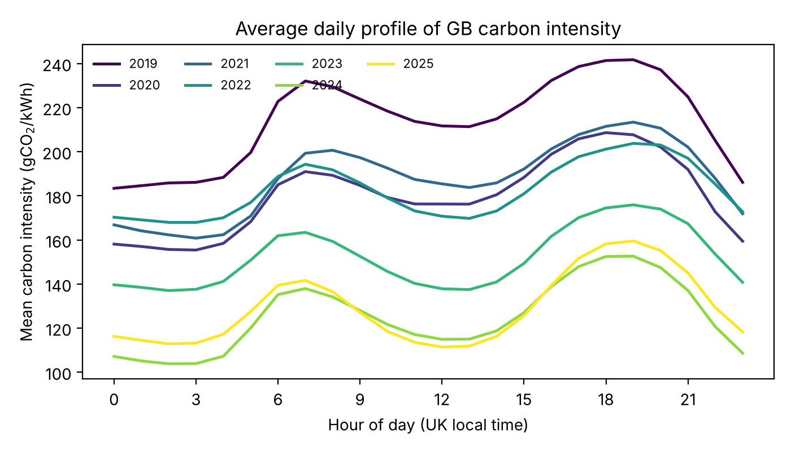
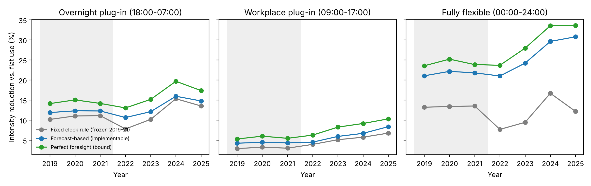

**Abstract.** Smart-charging tariffs and household advice in Great Britain usually treat the night as the low-carbon time to use electricity. This study tests whether that rule still holds as the grid decarbonises. Using 2019–2025 half-hourly public data from the NESO Carbon Intensity API and Elexon (about 120,000 half hours), I measure how the daily carbon-intensity profile has changed. I then simulate three-hour blocks of flexible demand, such as electric-vehicle charging, under four scheduling strategies. A fixed overnight schedule (01:00–03:30) is chosen on 2019–2021 data, frozen, and tested out of sample on 2022–2025. It is compared with a strategy that uses only the published day-ahead forecast, and with a perfect-foresight upper bound. Average grid intensity fell by 40% (214 to 129 gCO₂/kWh), and the share of half hours below 100 g rose from 2% to 37%. The absolute within-day spread stayed close to 90–100 g, so its size relative to the mean rose from 48% to 73%. In 2025, for the first time, the cleanest hour on average was midday (12:00) rather than night. For fully flexible demand, the forecast-based strategy cut average intensity by 21% in 2019 and 31% in 2025, relative to flat use. The frozen overnight rule stayed at 8–17%, so its share of the achievable saving fell from about 63% to 40%. Half of the slots the forecast strategy chose in 2025 were daytime slots. A cruder marginal-emissions estimate, however, still favours the night. This shows that the "best time" depends on the accounting metric, and that question deserves better marginal-emissions data.

**Keywords:** carbon intensity; demand flexibility; electric vehicles; marginal emissions; Great Britain; solar.

## 1. Introduction

Great Britain's electricity has decarbonised faster than that of almost any other large economy, largely through the exit from coal and the growth of wind (Staffell, 2017). Because grid carbon intensity now varies a great deal over the day, *when* electricity is used matters as well as *how much*. Smart-charging products, time-of-use tariffs and public advice commonly turn this into a simple rule: use flexible electricity at night.

This rule was formed when night demand was low and solar output small. As wind and solar capacity grow, the daily shape of carbon intensity changes, and a rule that was right in 2019 may be wrong by 2025. This paper asks three questions:

1. **RQ1.** How have the level and the *daily shape* of GB carbon intensity changed between 2019 and 2025?
2. **RQ2.** How much carbon intensity can flexible demand avoid by moving in time, and how is that changing?
3. **RQ3.** Does a fixed clock rule, set on past data and then left unchanged, keep pace with a strategy that reacts to the published forecast?

The contribution is deliberately modest. I do not propose a new estimation method. Instead I (i) bring the evidence up to date to the end of 2025 using only public data, (ii) test a fixed rule *out of sample*, which mirrors how such rules are used in practice, and (iii) show that the conclusion can flip when average emission factors are swapped for marginal ones. All code is public, and the full analysis can be re-run with two commands.

## 2. Data

| Source | Variable | Resolution | Period used |
|---|---|---|---|
| NESO Carbon Intensity API (national) | Actual and forecast intensity (gCO₂/kWh) | 30 min | 2019–2025 |
| NESO Carbon Intensity API (generation) | Generation mix (%) by fuel | 30 min | 2019–2025 |
| Elexon Insights, FUELHH | Transmission-metered generation by fuel (MW), interconnector flows | 30 min | 2019–2025 |

The national intensity series covers the whole GB system, including an estimate of embedded wind and solar. The Elexon series covers transmission-connected generation only, and is used solely for the marginal-emissions robustness check (Section 3.3). Forecast values above 1,000 g or at or below 0 g (fewer than 0.1% of records) were treated as missing as data artefacts. The mean absolute error of the forecast against the actual value over the period is 11.5 gCO₂/kWh. Times are converted to UK local time, so "02:00" means 02:00 on the household's clock in both GMT and BST.

## 3. Methods

### 3.1 Descriptive trends (RQ1)

For each calendar year I report mean intensity, mean wind and solar shares, the share of half hours below 100 gCO₂/kWh, and the median daily spread (daily maximum minus minimum). I also report the clock hour with the lowest mean intensity. As a simple summary of how strongly intensity responds to each source, I regress intensity on wind, solar and nuclear shares with month and hour-of-day fixed effects, separately for each year (Newey–West standard errors, 48 lags). Intensity is largely an *accounting identity* of the mix, so these coefficients describe the system and say nothing about causes. They are used only to show how the effect of one extra percentage point of wind changes over time.

### 3.2 Load-shifting experiment (RQ2, RQ3)

Each day I give a hypothetical user a flexible energy need of six half-hour slots (three hours, roughly 21 kWh at a 7 kW home charger) inside an availability window. I use three windows: overnight (18:00–07:00), workplace (09:00–17:00) and fully flexible (00:00–24:00). Four strategies are compared:

* **Charge on arrival:** the first six slots of the window.
* **Fixed clock rule:** the six slots with the lowest mean actual intensity over 2019–2021 in that window. The rule is then *frozen* and applied unchanged in 2022–2025. For the overnight and fully flexible windows this rule is 01:00–03:30; for the workplace window it is 11:30–14:00.
* **Forecast-based:** each day, the six slots with the lowest *forecast* intensity. This needs only information that is publicly available in advance, so it can be implemented.
* **Perfect foresight:** the six slots with the lowest *actual* intensity. This is an upper bound and cannot be achieved in practice.

Every strategy is scored on *actual* intensity. The headline metric is the percentage reduction in mean intensity compared with spreading the same energy evenly across the window ("flat use"). For the gap between the forecast-based and fixed strategies I report a 95% interval from a paired bootstrap over days (2,000 resamples).

Choosing the fixed rule on one period and scoring it on a later one is the same in-sample versus out-of-sample discipline used in forecasting. It answers a practical question: if an app or a tariff fixed its "green hours" a few years ago and has not changed them since, how much does it now miss?

### 3.3 Robustness: marginal emission factors

Average intensity tells us the emissions *share* of a kWh. The emissions *caused* by an extra kWh depend on which plant responds, which is the marginal emission factor (MEF). Following Hawkes (2010) and Siler-Evans et al. (2012), I regress the change in GB fossil CO₂ emissions between consecutive half hours on the change in total supply. I do this by year and by four-hour block, using direct-combustion factors from the NESO methodology (coal 937, CCGT 394, OCGT 651, oil 935, biomass 120, other 300 gCO₂/kWh; Bruce et al., 2017). Interconnectors and pumped storage are treated as zero-emission at the GB boundary. Confidence intervals come from 300 bootstrap resamples. This estimate is intentionally simple, and its limits are discussed in Section 6.

## 4. Results

### 4.1 The daily shape has changed (RQ1)

**Table 1.** GB grid summary by year.

| Year | Mean intensity (g/kWh) | Wind % | Solar % | Gas % | % of half hours < 100 g | Median daily spread (g) | Spread / mean | Cleanest hour |
|---|---|---|---|---|---|---|---|---|
| 2019 | 214.0 | 17.9 | 4.1 | 40.1 | 2.2 | 103 | 48% | 00:00 |
| 2020 | 180.3 | 22.0 | 4.5 | 36.3 | 8.9 | 95 | 53% | 03:00 |
| 2021 | 187.8 | 21.6 | 3.8 | 38.1 | 9.2 | 88 | 47% | 03:00 |
| 2022 | 182.5 | 27.4 | 4.0 | 39.3 | 14.6 | 89 | 49% | 03:00 |
| 2023 | 152.1 | 29.2 | 4.4 | 33.0 | 25.4 | 93 | 61% | 02:00 |
| 2024 | 125.1 | 31.2 | 4.9 | 25.6 | 40.5 | 90 | 72% | 02:00 |
| 2025 | 129.2 | 32.3 | 6.5 | 27.5 | 37.4 | 94 | 73% | **12:00** |

Mean intensity fell by 40% between 2019 and 2025, with a pause in 2021–2022 (low wind in 2021, higher gas use in 2022). The absolute daily spread barely moved, so timing now accounts for a much larger share of a kWh's carbon. Figure 1 shows the daily profile: the midday trough has deepened compared with the night, and in 2025 the mean at 12:00–13:00 (about 111 g) was slightly below the overnight minimum (about 113 g). The evening peak around 18:00–19:00 is still the dirtiest time in every year.

The year-by-year regressions show that one extra percentage point of wind share was associated with a 4.1 g/kWh lower intensity in 2019, but only 3.0 g/kWh in 2025 (standard errors around 0.05). This is what we would expect: as gas output shrinks, each additional unit of wind displaces less fossil generation.

### 4.2 The value of moving demand is rising (RQ2)

Figure 3 and Table 2 show the reduction in intensity compared with flat use. Within the overnight window the achievable saving grew modestly (forecast-based: 12% in 2019, 15–16% in 2024–2025). Within the workplace window it doubled from a small base (4% to 8%), which reflects the growing midday solar trough. The fully flexible case grew the most: the forecast-based strategy cut intensity by 21% in 2019 and 31% in 2025.

**Table 2.** Reduction in mean intensity compared with flat use, fully flexible window (00:00–24:00).

| Year | Fixed 01:00–03:30 | Forecast-based | Perfect foresight | Forecast slots in 09:00–17:00 |
|---|---|---|---|---|
| 2019 | 13.2% | 21.0% | 23.5% | 24% |
| 2020 | 13.4% | 22.2% | 25.2% | 30% |
| 2021 | 13.5% | 21.8% | 23.8% | 25% |
| 2022\* | 7.7% | 21.0% | 23.7% | 36% |
| 2023\* | 9.5% | 24.2% | 27.9% | 44% |
| 2024\* | 16.7% | 29.6% | 33.5% | 39% |
| 2025\* | 12.2% | 30.8% | 33.6% | 50% |

\* Out-of-sample years for the fixed rule.

The forecast-based strategy reaches 87–92% of the perfect-foresight bound in every year. Day-ahead forecasts are therefore good enough to capture nearly all of the available saving.

### 4.3 A frozen overnight rule is falling behind (RQ3)

Within the overnight window, the frozen 01:00–03:30 rule still does well: it trails the forecast-based strategy by only 0.8–5.2 g/kWh (all bootstrap intervals exclude zero). Someone who can only charge at home overnight loses little by using a timer.

For fully flexible demand the picture is different. The fixed rule's share of the forecast-based saving fell from 63% in 2019 to 40% in 2025. The gap between the two widened from about 17 to 24 g/kWh (2025 interval 21–27 g/kWh). The cause is visible in Figure 4: the forecast-based strategy put a quarter of its slots in the daytime in 2019 and half of them in 2025. "Overnight" is no longer a safe default for flexible demand that can run at any time of day.

### 4.4 Robustness: the metric matters

The marginal-emissions estimate does **not** agree. By this measure the 00:00–04:00 block has the *lowest* marginal factor in every year from 2023 (about 95 g/kWh, compared with 140–190 g at midday and 250–290 g in the evening). Scored on marginal factors, the fixed overnight rule beats the forecast-based strategy in the fully flexible window (for example 52% compared with 11% below flat use in 2025). The obvious interpretation is that changes in demand at night are increasingly met by imports and storage, which this simple model counts as zero at the GB boundary, while at midday they are met by GB gas plant. This is the well-known gap between average and marginal accounting (Siler-Evans et al., 2012), and it is unresolved here. Average intensity is the metric that consumer apps and the NESO API actually publish. The marginal result means that claims about "green hours" should state which metric they use.

## 5. Discussion

The evidence supports three conclusions. First, decarbonisation has not removed the reason to shift demand. It has made shifting *more* valuable in proportion, because the absolute daily spread has stayed roughly constant while the mean has fallen. Second, the cleanest time of day is moving towards midday as solar grows, so rules fixed on past data are losing value, while simple forecast-based scheduling keeps up. Third, both conclusions rest on average emission factors. Under a basic marginal-emissions view, the night still looks best, and a better MEF model is needed before strong policy claims can be made.

For policy and product design this suggests that time-of-use tariffs and smart-charging defaults should be reviewed regularly, or should follow the carbon forecast directly, instead of fixing "green hours" once. It also suggests that workplace and daytime charging deserves more attention as solar grows.

## 6. Limitations and further work

* **Average versus marginal.** The MEF model is a single-equation, domestic-boundary approximation. It ignores emissions behind interconnectors and the embedded generation that Elexon data does not meter. A natural extension is to give imports country-specific factors and to estimate MEFs by load level, not only by time of day.
* **No system feedback.** The experiment treats each user as small. If millions of users shift at once, they will create new peaks and change the marginal plant.
* **Behaviour.** A three-hour daily need and fixed windows are stylised assumptions. Real charging sessions vary.
* **Forecast vintage.** The API reports a single forecast per half hour. The exact lead time of that forecast is not recorded in the archive, so the forecast-based results may be slightly optimistic compared with a true day-ahead decision.
* **One year of the new pattern.** The midday shift in 2025 is a single-year observation and should be checked against 2026 data once the year is complete.

## 7. Reproducibility

All code and processed outputs are public at `github.com/richard663-ui/gb-grid-carbon-timing` (repository to be published). `python src/fetch_data.py` downloads the raw data (about 3 minutes) and `python src/analysis.py` reproduces every table and figure. The random seed is fixed.

## References

*(Verify every entry against the original source before submission.)*

* Bruce, A., Ruff, L., Kelloway, J., MacMillan, F. and Rogers, A. (2017). *Carbon Intensity Forecast Methodology.* National Grid ESO / Environmental Defense Fund Europe / University of Oxford / WWF.
* Hawkes, A. D. (2010). Estimating marginal CO₂ emissions rates for national electricity systems. *Energy Policy*, 38(10), 5977–5987.
* Siler-Evans, K., Azevedo, I. L. and Morgan, M. G. (2012). Marginal emissions factors for the U.S. electricity system. *Environmental Science & Technology*, 46(9), 4742–4748.
* Staffell, I. (2017). Measuring the progress and impacts of decarbonising British electricity. *Energy Policy*, 102, 463–475.
* NESO Carbon Intensity API, https://carbonintensity.org.uk (accessed November 2026).
* Elexon Insights Solution, FUELHH dataset, https://bmrs.elexon.co.uk (accessed November 2026).
