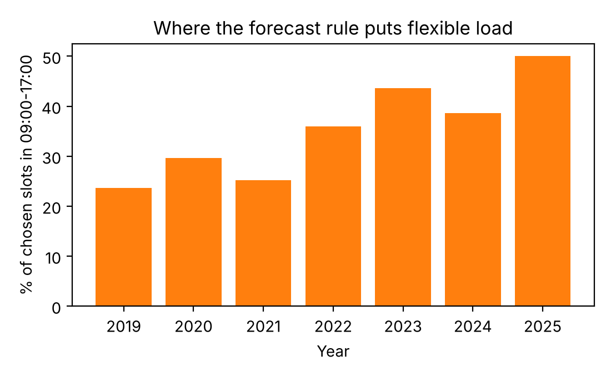
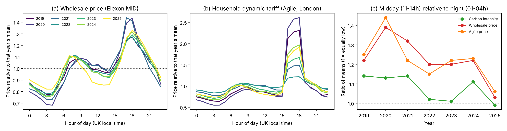
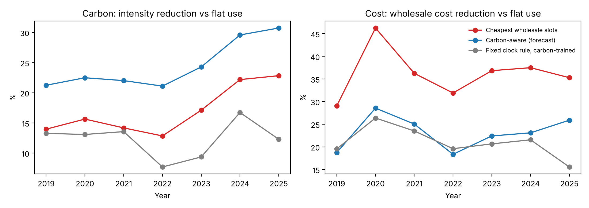
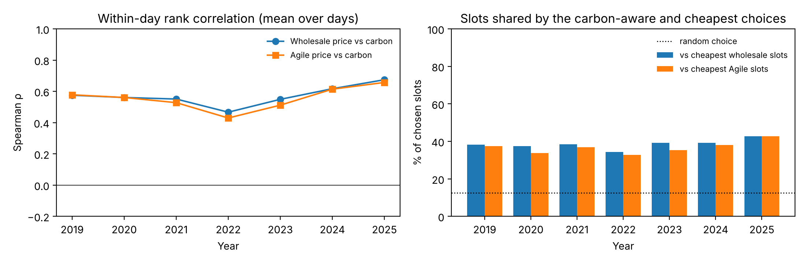
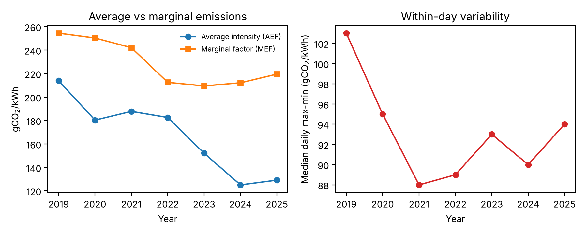

**Abstract.** Advice and tariffs in Great Britain usually treat the night as the cleanest and cheapest time to use electricity. This study tests whether that is still true, and whether the cleanest and the cheapest times coincide. It uses public half-hourly data for 2019–2025: NESO carbon intensity, Elexon generation and wholesale prices, and Octopus Agile household prices. Average carbon intensity fell by 40% (from 214 to 129 gCO₂/kWh), but the daily range between the cleanest and dirtiest times stayed near 90–100 g, so timing now matters relatively more. In 2025, for the first time, midday was on average as clean as the night (midday-to-night ratio 0.99, down from 1.14 in 2019), and wholesale power at midday was within 3% of the night price (1.03, down from 1.22). I simulate flexible demand under several scheduling strategies. A strategy that uses only the public carbon forecast cut intensity by 21% in 2019 and 31% in 2025, compared with spreading use evenly over the day. A fixed 01:00–03:30 rule chosen on 2019–2021 data achieved only 8–17% out of sample. Price and carbon mostly point the same way: their mean within-day rank correlation was 0.47–0.67, and choosing the cheapest wholesale slots captured 61–75% of the carbon saving while cutting wholesale energy cost by 29–46%. For an illustrative electric car charging 7 kWh a day on a dynamic tariff, choosing the cheapest hour saved about £110–£230 a year (£198 in 2025). A flat tariff rewards no shifting at all. The remaining carbon saving is expensive: moving from the cheapest schedule to the carbon-aware one implies £277–£1,787 per tonne of CO₂, far above the carbon price paid by generators. A simple marginal-emissions model still favours the night, so the "best time" depends on how emissions are counted.

**Key findings**

1. **Timing matters more, not less.** Carbon intensity fell by 40% between 2019 and 2025, but the daily range did not shrink, so it grew from 48% to 73% of the mean.
2. **Midday has caught up with the night.** In 2025 midday was as clean as the night for the first time, and wholesale prices at midday were within 3% of night prices (22% higher in 2019).
3. **Fixed "night-time" rules are falling behind.** For demand that can run at any time, a rule frozen on 2019–2021 data captured 61–63% of the forecast-based carbon saving in those years, but only 37–56% in 2022–2025 (40% in 2025).
4. **Cheap and clean mostly coincide.** Following the wholesale price alone delivered 61–75% of the carbon saving of the carbon-aware schedule, while cutting wholesale energy cost by 29–46%.
5. **Households only benefit on dynamic tariffs.** On Agile, an electric car charging 7 kWh a day saved about £198 in 2025 by charging in the cheapest hour (£198–£229 across all 14 GB regions). On a flat tariff the saving is zero.
6. **The last tonnes are costly, and the metric matters.** Chasing carbon beyond what prices already reward costs £277–£1,787 per tonne of CO₂. On marginal rather than average emission factors, the night still looks best.

**Keywords:** carbon intensity; electricity prices; demand flexibility; dynamic tariffs; electric vehicles; marginal emissions; Great Britain.

## 1. Introduction

Great Britain's electricity has decarbonised faster than that of almost any other large economy, largely through the exit from coal and the growth of wind (Staffell, 2017). Because grid carbon intensity now varies a great deal over the day, *when* electricity is used matters as well as *how much*. Smart-charging products, time-of-use tariffs and public advice commonly turn this into a simple rule: use flexible electricity at night, when it is both cleaner and cheaper.

This rule was formed when night demand was low and solar output small. As wind and solar capacity grow, the daily shape of carbon intensity and of prices changes, and a rule that was right in 2019 may be wrong by 2025. For households, carbon is only part of the decision; most people also, or mainly, care about cost. This paper asks four questions:

1. **RQ1.** How have the level and the *daily shape* of GB carbon intensity changed between 2019 and 2025?
2. **RQ2.** How much carbon intensity can flexible demand avoid by moving in time, and how is that changing?
3. **RQ3.** Does a fixed clock rule, set on past data and then left unchanged, keep pace with a strategy that reacts to the published forecast?
4. **RQ4.** When is electricity cheapest, how much can flexible demand save, and do the cheapest and the cleanest times coincide?

### 1.1 Related work

Two GB studies are closest to this paper. Tang et al. (2021) combine hourly marginal emission factors with a life-cycle assessment of home EV charging. They find that marginal factors give 25% higher emissions than average ones, and that smart charging cuts emissions by up to about 6% for typical overnight charging patterns. Mehlig et al. (2022) pair national EV charging data with high-resolution generation data. They find that smart charging lowers *average* CO₂ emissions by about 10% but may *raise* marginal emissions. They therefore argue for 24-hour opportunistic charging that targets marginal emissions. Both studies use data up to 2019–2020. The marginal-emission method follows Hawkes (2010) for GB and Siler-Evans et al. (2012) for the US, and the long-run drivers of GB decarbonisation are reviewed by Staffell (2017).

The contribution of this paper is deliberately modest. I do not propose a new estimation method. Instead I (i) bring the evidence up to date to the end of 2025 using only public data, (ii) test a fixed rule *out of sample*, which mirrors how such rules are used in practice, (iii) put carbon and cost side by side on the same days, at the wholesale and household level, and price the trade-off between them, and (iv) show that the conclusion can flip when average emission factors are swapped for marginal ones. All code is public, and the whole analysis can be re-run with four commands.

## 2. Data

| Source | Variable | Resolution | Period used |
|---|---|---|---|
| NESO Carbon Intensity API (national) | Actual and forecast intensity (gCO₂/kWh) | 30 min | 2019–2025 |
| NESO Carbon Intensity API (generation) | Generation mix (%) by fuel | 30 min | 2019–2025 |
| Elexon Insights, FUELHH | Transmission-metered generation by fuel (MW), interconnector flows | 30 min | 2019–2025 |
| Elexon Insights, MID (provider APXMIDP) | Wholesale market index price (£/MWh) and volume | 30 min | 2019–2025 |
| Octopus Energy public API, Agile Octopus | Household dynamic unit rate (p/kWh, incl. 5% VAT) | 30 min | 2019–2025 (London); 2025 (all 14 regions) |

The national intensity series covers the whole GB system: gas, coal, oil, biomass, nuclear, hydro, wind, solar, pumped storage and imports, including an estimate of embedded wind and solar. Nuclear provided 17% of generation on average over the period. Because nuclear output is close to constant over a day, it lowers the *level* of carbon intensity but hardly changes its *daily shape*. That is why the analysis focuses on wind and solar when explaining timing, while every source is counted in the intensity figures. The Elexon FUELHH series covers transmission-connected generation only, and is used only for the marginal-emissions robustness check (Section 3.3). Forecast values above 1,000 g or at or below 0 g (fewer than 0.1% of records) were treated as missing as data artefacts. The mean absolute error of the forecast against the actual value over the period is 11.5 gCO₂/kWh. Times are converted to UK local time, so "02:00" means 02:00 on the household's clock in both GMT and BST.

**Prices.** The market index price (MID) is Elexon's half-hourly reference price for short-term wholesale trading, published by the EPEX Spot index provider (APXMIDP). Half hours with zero traded volume carry a placeholder price of zero and are treated as missing. MID covers 94–100% of half hours in each year. Most gaps are whole days in 2019–2021 (39, 40 and 27 days with some missing data); such days are dropped from the comparisons below. Negative prices are kept, because they are real. Agile Octopus is a dynamic household tariff whose half-hourly unit rates, derived from day-ahead wholesale prices, are published the afternoon before. Its rates exclude the daily standing charge, which does not depend on timing. Agile has been sold under seven successive product codes since 2018. For each half hour I use the product that was most recently launched for new customers; the autumn-2022 pause in new sign-ups is covered by the August 2022 product. The main series is for London (region C). All prices are nominal.

## 3. Methods

### 3.1 Descriptive trends (RQ1)

For each calendar year I report mean intensity, mean wind and solar shares, the share of half hours below 100 gCO₂/kWh, and the median daily spread (daily maximum minus minimum). I also report the clock hour with the lowest mean intensity, and the ratio of mean intensity at midday (11:00–14:00) to that at night (01:00–04:00). As a simple summary of how strongly intensity responds to each source, I regress intensity on wind, solar and nuclear shares with month and hour-of-day fixed effects, separately for each year (Newey–West standard errors, 48 lags). Intensity is largely an *accounting identity* of the mix, so these coefficients describe the system and say nothing about causes. They are used only to show how the effect of one extra percentage point of wind changes over time.

### 3.2 Load-shifting experiment (RQ2, RQ3)

Each day I give a hypothetical user a flexible energy need of six half-hour slots (three hours, roughly 21 kWh at a 7 kW home charger) inside an availability window. I use three windows: overnight (18:00–07:00), workplace (09:00–17:00) and fully flexible (00:00–24:00). Four strategies are compared:

* **Charge on arrival:** the first six slots of the window.
* **Fixed clock rule:** the six slots with the lowest mean actual intensity over 2019–2021 in that window. The rule is then *frozen* and applied unchanged in 2022–2025. For the overnight and fully flexible windows this rule is 01:00–03:30; for the workplace window it is 11:30–14:00.
* **Forecast-based (carbon-aware):** each day, the six slots with the lowest *forecast* intensity. This needs only information that is publicly available in advance, so it can be implemented.
* **Perfect foresight:** the six slots with the lowest *actual* intensity. This is an upper bound and cannot be achieved in practice.

Every strategy is scored on *actual* intensity. The headline metric is the percentage reduction in mean intensity compared with spreading the same energy evenly across the window ("flat use"). For the gap between the forecast-based and fixed strategies I report a 95% interval from a paired bootstrap over days (2,000 resamples).

Choosing the fixed rule on one period and scoring it on a later one is the same in-sample versus out-of-sample discipline used in forecasting. It answers a practical question: if an app or a tariff fixed its "green hours" a few years ago and has not changed them since, how much does it now miss?

### 3.3 Robustness: marginal emission factors

Average intensity tells us the emissions *share* of a kWh. The emissions *caused* by an extra kWh depend on which plant responds, which is the marginal emission factor (MEF). Following Hawkes (2010) and Siler-Evans et al. (2012), I regress the change in GB fossil CO₂ emissions between consecutive half hours on the change in total supply. I do this by year and by four-hour block, using direct-combustion factors from the NESO methodology (coal 937, CCGT 394, OCGT 651, oil 935, biomass 120, other 300 gCO₂/kWh; Bruce et al., 2024). In the main specification, interconnectors and pumped storage are treated as zero-emission at the GB boundary. In a second specification, positive import flows are charged at NESO's default factors for the connected system (France 53, Netherlands 474, Belgium 179, Ireland 458 gCO₂/kWh). Norway and Denmark are not listed in that table and are left at zero. Confidence intervals come from 300 bootstrap resamples. This estimate is intentionally simple, and its limits are discussed in Section 6.

### 3.4 Cost and the carbon–cost trade-off (RQ4)

The same simulation is re-run on a **common sample** of days that have complete carbon, forecast, wholesale and Agile data, so that carbon and cost are always compared on identical days (312–362 days a year in the fully flexible window; days with a clock change are excluded). Two cost-driven strategies are added:

* **Cheapest wholesale slots:** each day, the slots with the lowest MID price. MID is an ex-post index, so this treats short-term prices as known in advance; a robustness check gives the carbon-aware strategy perfect information too.
* **Cheapest Agile slots:** each day, the slots with the lowest Agile rate. Agile rates are published the day before, so this strategy can be implemented by a household.

Every strategy is scored on actual intensity, on the mean wholesale price paid and on the mean Agile rate paid. Four measures describe how far carbon and cost agree:

1. the mean within-day Spearman rank correlation between price and intensity across the 48 half hours of each day;
2. the share of slots that the carbon-aware and the cheapest strategies both choose, compared with the share two random choices would have in common;
3. the share of the carbon-aware strategy's carbon saving that the cheapest strategy also achieves, (I_flat − I_cheap) / (I_flat − I_carbon), and the corresponding share of the cost saving the other way round;
4. the **implied abatement cost** of choosing the carbon-aware schedule instead of the cheapest one: AC = (P_carbon − P_cheap) / (I_cheap − I_carbon), where P is the mean price paid (£/MWh) and I is mean intensity (tCO₂/MWh). Its 95% interval comes from a bootstrap over days (2,000 resamples).

The main comparison uses six slots per day in the fully flexible window. For the household illustration I use two slots a day (one hour at 7 kW, so 7 kWh a day or about 2,560 kWh a year, an illustrative figure), and translate savings into pounds a year. Sensitivity runs cover 2, 6 and 12 slots and all three windows.

## 4. Results

### 4.1 The daily shape has changed (RQ1)

**Table 1.** GB grid summary by year.

| Year | Mean intensity (g/kWh) | Wind % | Solar % | Gas % | % of half hours < 100 g | Median daily spread (g) | Spread / mean | Cleanest hour |
|---|---|---|---|---|---|---|---|---|
| 2019 | 214.0 | 17.9 | 4.1 | 40.1 | 2.2 | 103 | 48% | 00:00 |
| 2020 | 180.3 | 22.0 | 4.5 | 36.3 | 8.9 | 95 | 53% | 03:00 |
| 2021 | 187.8 | 21.6 | 3.8 | 38.1 | 9.2 | 88 | 47% | 03:00 |
| 2022 | 182.5 | 27.4 | 4.0 | 39.3 | 14.6 | 89 | 49% | 03:00 |
| 2023 | 152.1 | 29.2 | 4.4 | 33.0 | 25.4 | 93 | 61% | 02:00 |
| 2024 | 125.1 | 31.2 | 4.9 | 25.6 | 40.5 | 90 | 72% | 02:00 |
| 2025 | 129.2 | 32.3 | 6.5 | 27.5 | 37.4 | 94 | 73% | **12:00** |

Mean intensity fell by 40% between 2019 and 2025, with a pause in 2021–2022 (low wind in 2021, higher gas use in 2022). The absolute daily spread barely moved, so timing now accounts for a much larger share of a kWh's carbon. Figure 1 shows the daily profile: the midday trough has deepened compared with the night, and in 2025 the mean at 12:00–13:00 (about 111 g) was slightly below the overnight minimum (about 113 g). The evening peak around 18:00–19:00 is still the dirtiest time in every year.

The year-by-year regressions show that one extra percentage point of wind share was associated with a 4.1 g/kWh lower intensity in 2019, but only 3.0 g/kWh in 2025 (standard errors around 0.05). This is what we would expect: as gas output shrinks, each additional unit of wind displaces less fossil generation.

### 4.2 The value of moving demand is rising (RQ2)

Figure 2 and Table 2 show the reduction in intensity compared with flat use. Within the overnight window the achievable saving grew modestly (forecast-based: 12% in 2019, 15–16% in 2024–2025). Within the workplace window it doubled from a small base (4% to 8%), which reflects the growing midday solar trough. The fully flexible case grew the most: the forecast-based strategy cut intensity by 21% in 2019 and 31% in 2025.

**Table 2.** Reduction in mean intensity compared with flat use, fully flexible window (00:00–24:00).

| Year | Fixed 01:00–03:30 | Forecast-based | Perfect foresight | Forecast slots in 09:00–17:00 |
|---|---|---|---|---|
| 2019 | 13.2% | 21.0% | 23.5% | 24% |
| 2020 | 13.4% | 22.2% | 25.2% | 30% |
| 2021 | 13.5% | 21.8% | 23.8% | 25% |
| 2022\* | 7.7% | 21.0% | 23.7% | 36% |
| 2023\* | 9.5% | 24.2% | 27.9% | 44% |
| 2024\* | 16.7% | 29.6% | 33.5% | 39% |
| 2025\* | 12.2% | 30.8% | 33.6% | 50% |

\* Out-of-sample years for the fixed rule.

{width=100%}

The forecast-based strategy reaches 87–92% of the perfect-foresight bound in every year. Day-ahead forecasts are therefore good enough to capture nearly all of the available saving.

### 4.3 A frozen overnight rule is falling behind (RQ3)

Within the overnight window, the frozen 01:00–03:30 rule still does well: it trails the forecast-based strategy by only 0.8–5.2 g/kWh (all bootstrap intervals exclude zero). Someone who can only charge at home overnight loses little by using a timer.

For fully flexible demand the picture is different. The fixed rule delivered 61–63% of the forecast-based saving in the three years used to choose it, but only 37–56% in the four later years (40% in 2025). The gap between the two was about 16–17 g/kWh in 2019–2021 and 22–24 g/kWh in 2022, 2023 and 2025 (2025 interval 21–27 g/kWh); 2024 was an exception at 16 g/kWh. The cause is visible in Figure 3: the forecast-based strategy put a quarter of its slots in the daytime in 2019 and half of them in 2025. "Overnight" is no longer a safe default for flexible demand that can run at any time of day.

### 4.4 When is electricity cheapest? (RQ4)

**Table 3.** Wholesale and household prices by year, and the depth of the midday trough.

| Year | Wholesale (£/MWh) | Spread (£/MWh) | Negative prices | Agile (p/kWh) | Agile spread (p/kWh) | M/N carbon | M/N wholesale | M/N Agile |
|---|---|---|---|---|---|---|---|---|
| 2019 | 41.8 | 29.8 | 0.3% | 10.6 | 19.0 | 1.14 | 1.22 | 1.25 |
| 2020 | 33.5 | 32.6 | 2.0% | 9.0 | 19.6 | 1.13 | 1.39 | 1.44 |
| 2021 | 115.1 | 67.6 | 0.4% | 22.1 | 19.5 | 1.14 | 1.32 | 1.22 |
| 2022 | 198.2 | 144.0 | 0.7% | 35.8 | 15.4 | 1.02 | 1.20 | 1.15 |
| 2023 | 93.5 | 72.1 | 2.5% | 21.1 | 22.5 | 1.01 | 1.20 | 1.22 |
| 2024 | 71.4 | 55.9 | 2.8% | 16.8 | 23.5 | 1.11 | 1.22 | 1.23 |
| 2025 | 79.9 | 61.3 | 2.8% | 18.5 | 24.2 | **0.99** | **1.03** | **1.06** |

Wholesale and Agile are annual means. Spread is the median over days of the daily maximum minus minimum. Negative prices is the share of half hours with a wholesale price below zero. M/N (midday ÷ night) is the mean over 11:00–14:00 divided by the mean over 01:00–04:00; 1.00 means equally low.

Prices tell a story of crisis and recovery (Table 3). The gas-price shock lifted mean wholesale prices from about £34–42/MWh in 2019–2020 to £198/MWh in 2022, before they eased to £71–80/MWh in 2024–2025. In every year the cheapest hour on average was 03:00 or 04:00, and the most expensive was 17:00 or 18:00. Agile household rates follow the wholesale shape but add a large 16:00–19:00 peak (Figure 4b). In 2022 Agile's price cap compressed its daily range, and on 45 days in the sample the rate was the same all day.

Two changes mirror the carbon results. First, negative wholesale prices, when sellers in effect pay buyers to take power, rose from 0.3% of half hours in 2019 to 2.8% in 2024–2025. Second, the midday trough in prices has deepened. In 2019 wholesale power at midday cost 22% more than at night. In 2025 the gap was 3%, the same year in which midday became as clean as the night (Figure 4c). The night is still marginally the cheapest time, but a second, almost equally cheap window has opened at midday.

{width=100%}

### 4.5 Cheap and clean mostly coincide, but not completely (RQ4)

**Table 4.** Carbon and wholesale cost compared with flat use, fully flexible window, six slots a day (common sample of 312–362 days a year). Negative numbers are reductions. "Carbon kept by cheapest" is the share of the carbon-aware strategy's carbon saving that the cheapest strategy also achieves; "Cost kept by carbon-aware" is the reverse for cost. The last column is the implied abatement cost of choosing the carbon-aware over the cheapest schedule.

| Year | Cheapest: cost | Cheapest: carbon | Carbon-aware: cost | Carbon-aware: carbon | Carbon kept by cheapest | Cost kept by carbon-aware | £/tCO₂ (95% CI) |
|---|---|---|---|---|---|---|---|
| 2019 | −29.0% | −14.0% | −18.7% | −21.2% | 66% | 64% | 277 (233–338) |
| 2020 | −46.3% | −15.6% | −28.6% | −22.5% | 69% | 62% | 483 (397–597) |
| 2021 | −36.3% | −14.2% | −25.0% | −22.0% | 64% | 69% | 885 (753–1,053) |
| 2022 | −31.9% | −12.8% | −18.4% | −21.1% | 61% | 58% | 1,787 (1,530–2,110) |
| 2023 | −36.8% | −17.1% | −22.4% | −24.3% | 70% | 61% | 1,236 (1,025–1,499) |
| 2024 | −37.5% | −22.2% | −23.1% | −29.6% | 75% | 62% | 1,109 (884–1,388) |
| 2025 | −35.3% | −22.8% | −25.9% | −30.7% | 74% | 73% | 736 (603–925) |

The carbon-aware results on this common sample match the full-sample results in Table 2 to within 0.3 percentage points, so restricting the days does not change the carbon story.

**Price and carbon usually point the same way.** The mean within-day rank correlation between wholesale price and intensity was 0.47–0.67, and it was positive on 86–99% of days. It was weakest in 2022, when gas prices dominated, and strongest in 2025 (Figure 6a). The carbon-aware and the cheapest strategies chose the same slot 34–43% of the time, about three times what two random choices would share (12.5%) (Figure 6b).

**Following the price gets most of the carbon benefit.** Choosing the cheapest wholesale slots cut wholesale energy cost by 29–46% (£28/MWh in 2025), and as a side effect cut carbon intensity by 13–23%, which is 61–75% of what the carbon-aware strategy achieves. The other way round, the carbon-aware strategy captured 58–73% of the possible cost saving (Figure 5). A fixed 01:00–03:30 rule saved 20–26% on cost in 2019–2024, but only 16% in 2025.

{width=100%}

{width=100%}

**The rest of the carbon saving is expensive.** Going from the cheapest schedule to the carbon-aware one cuts more carbon, but at an implied cost of £277–£1,787 per tonne of CO₂ (Table 4), highest in the 2022 price crisis. Giving the carbon-aware strategy perfect information as well lowers this to £222–£1,308 per tonne (£537 in 2025, 95% CI 457–622), but does not change the conclusion. For comparison, UK ETS auctions cleared at £32.10–£46.92 per tonne in 2024 (UK ETS Authority, 2025), the ETS price set for 2025 penalty purposes was £41.84 (DESNZ, 2024), and GB generators also pay the £18 per tonne Carbon Price Support (Deloitte, 2024). Together this is roughly £50–£65 per tonne. Even the government's central appraisal value for carbon, £248 per tonne for 2022 and £260 for 2025 in 2020 prices (DESNZ, 2021), is below the implied cost in every year from 2020 onwards, even allowing for inflation since 2020. In other words, prices already reward most of the carbon benefit of shifting. Squeezing out the rest by ignoring price is a costly way to cut emissions, unless carbon were priced much more heavily into electricity prices.

### 4.6 What it means for a household

**Table 5.** Illustrative electric car charging 7 kWh a day (one hour at 7 kW) on Agile Octopus, London, fully flexible window.

| Year | Flat use (p/kWh) | Cheapest hour (p/kWh) | Saving | £/year, cheapest | £/year, carbon-aware | Carbon cut, cheapest | Carbon cut, carbon-aware |
|---|---|---|---|---|---|---|---|
| 2019 | 10.6 | 6.3 | 41% | £111 | £73 | 17% | 24% |
| 2020 | 8.9 | 4.1 | 54% | £124 | £76 | 17% | 24% |
| 2021 | 22.7 | 16.0 | 29% | £171 | £106 | 16% | 24% |
| 2022 | 35.7 | 26.8 | 25% | £227 | £111 | 14% | 23% |
| 2023 | 21.1 | 12.4 | 41% | £221 | £118 | 17% | 26% |
| 2024 | 16.8 | 9.2 | 45% | £194 | £120 | 25% | 31% |
| 2025 | 18.6 | 10.9 | 42% | £198 | £132 | 25% | 33% |

On a dynamic tariff, charging in the cheapest hour every day cut the energy price paid by 25–54% compared with flat use. For the illustrative car this is worth £111–£227 a year (£198 in 2025), and it also cut the carbon intensity of charging by 14–25%. Choosing the cleanest forecast hour instead saved less money (£73–£132 a year) but cut more carbon (23–33%). Across all 14 GB regions in 2025 the cheapest-hour saving was 41–43%, or £198–£229 a year, because Agile's regional differences scale prices almost proportionally. On a flat tariff, which charges the same at every hour, the same behaviour saves nothing. A household's reason to shift therefore depends on its tariff, not only on the grid.

### 4.7 Robustness

**Sensitivity to the amount of flexible demand and the window.** Across all three windows and 2, 6 or 12 slots a day, the cheapest-slot strategy captured 44–86% of the carbon-aware carbon saving (highest in the overnight window). The carbon-aware and cheapest strategies always shared more slots than random choices would. The implied abatement cost never fell below about £255 per tonne, or about £200 per tonne with perfect information on both sides.

**Marginal emissions: the metric matters.** The marginal-emissions estimate does **not** agree with the average-intensity results. By this measure the 00:00–04:00 block has the *lowest* marginal factor in every year from 2023 (about 95 g/kWh, compared with 140–190 g at midday and 250–290 g in the evening). Scored on marginal factors, the fixed overnight rule beats the forecast-based strategy in the fully flexible window (for example 52% compared with 11% below flat use in 2025). The obvious interpretation is that changes in demand at night are increasingly met by imports and storage, which this simple model counts as zero at the GB boundary, while at midday they are met by GB gas plant. Charging imports at NESO's default factors raises the night-time marginal factor (to about 120–130 g/kWh in 2023–2025) but does not change the ranking: the fixed overnight rule still beats the forecast-based strategy on marginal factors (41% compared with 9% below flat use in 2025). This matches Mehlig et al. (2022), who also found that smart charging which lowers average emissions can raise marginal ones. The gap between average and marginal accounting (Siler-Evans et al., 2012) is therefore a real feature of the GB system and not an artefact of one modelling choice, but it is not resolved here. Average intensity is the metric that consumer apps and the NESO API actually publish. The marginal result means that claims about "green hours" should state which metric they use. Because the night is still marginally the cheapest time, a marginal view would bring the cheapest and cleanest choices closer together, so the abatement-cost results above should be read as an average-emissions view.

## 5. Discussion

The evidence supports four conclusions. First, decarbonisation has not removed the reason to shift demand. It has made shifting *more* valuable in proportion, because the absolute daily spread has stayed roughly constant while the mean has fallen. Second, the cleanest time of day is moving towards midday as solar grows, and the price signal is following: by 2025 midday was as clean as the night and almost as cheap. Rules fixed on past data are therefore losing value, while forecast- or price-based scheduling keeps up. Third, cost and carbon mostly agree. Simply following the wholesale price delivers 61–75% of the carbon benefit while saving money, and following the Agile tariff built on it delivers 58–80%. Going further for carbon alone costs several hundred to almost two thousand pounds per tonne, far more than the carbon price, which points to carbon pricing, not consumer self-sacrifice, as the efficient way to close the gap. Fourth, the carbon conclusions rest on average emission factors. Under a basic marginal-emissions view the night still looks best, and a better MEF model is needed before strong policy claims can be made.

Compared with earlier GB work, the carbon savings found here are larger than the roughly 6% reported by Tang et al. (2021) for overnight smart charging. This is mainly because the fully flexible case lets demand move across the whole day, and because the 2023–2025 grid has much deeper daily troughs. The average-versus-marginal tension that Mehlig et al. (2022) identified using 2019 data still holds in 2025.

For policy and product design this suggests three things. Time-of-use tariffs and smart-charging defaults should be reviewed regularly, or should follow price or carbon forecasts directly, instead of fixing "green" or "off-peak" hours once. Off-peak windows that only cover the night, as traditional night-rate tariffs such as Economy 7 do, now miss an almost equally cheap and clean midday window. And because households on flat tariffs gain nothing from shifting, wider access to dynamic or time-of-use tariffs is a precondition for flexible demand to deliver its carbon and cost benefits.

## 6. Limitations and further work

* **Average versus marginal.** The MEF model is a single-equation approximation. Imports are charged only at fixed default factors, and embedded generation that Elexon does not meter is missing. A natural extension is to use time-varying import factors from ENTSO-E and to estimate MEFs by load level, not only by time of day.
* **Wholesale price measure.** MID is a short-term traded index, not the day-ahead auction price that dynamic tariffs are built from, and the cheapest-slot strategy treats it as known in advance. The Agile results, which use prices households actually see in advance, point the same way.
* **One tariff, nominal prices.** Agile is one supplier's product; other dynamic or time-of-use tariffs will differ. Prices are nominal and include the 2021–2022 crisis, so percentages are more comparable across years than pound values.
* **No system feedback.** The experiment treats each user as small. If millions of users shift at once, they will create new peaks, change the marginal plant and move prices.
* **Behaviour.** A fixed daily energy need and fixed windows are stylised assumptions. Real charging sessions vary, and the 7 kWh-a-day car is illustrative.
* **Forecast vintage.** The API reports a single forecast per half hour. The exact lead time of that forecast is not recorded in the archive, so the forecast-based results may be slightly optimistic compared with a true day-ahead decision.
* **One year of the new pattern.** The midday shift in 2025 is a single-year observation and should be checked against 2026 data once the year is complete.

## 7. Reproducibility

All code and processed outputs are public at <https://github.com/richard663-ui/gb-grid-carbon-timing>. `python src/fetch_data.py` and `python src/fetch_prices.py` download the raw data (a few minutes). `python src/analysis.py` reproduces the carbon tables and figures, and `python src/cost_analysis.py` reproduces the cost tables and figures. The random seeds are fixed.

## References

* Bruce, A. R. W., Ruff, L., Kelloway, J., MacMillan, F. and Rogers, A. (2024). *Carbon Intensity Regional Forecast Methodology.* National Energy System Operator (NESO), with Environmental Defense Fund Europe, WWF and the University of Oxford.
* Deloitte (2024). Autumn Budget 2024: Climate change levy and carbon price support. *TaxScape.* https://taxscape.deloitte.com (accessed November 2026).
* DESNZ (2021). *Valuation of greenhouse gas emissions: for policy appraisal and evaluation.* Department for Energy Security and Net Zero (first published 2 September 2021).
* DESNZ (2024). *UK ETS: Carbon price for use in civil penalties, 2025.* Department for Energy Security and Net Zero (published 28 November 2024).
* Hawkes, A. D. (2010). Estimating marginal CO₂ emissions rates for national electricity systems. *Energy Policy*, 38(10), 5977–5987.
* Mehlig, D., ApSimon, H. and Staffell, I. (2022). Emissions from charging electric vehicles in the UK. *Transportation Research Part D: Transport and Environment*, 110, 103430. https://doi.org/10.1016/j.trd.2022.103430
* Siler-Evans, K., Azevedo, I. L. and Morgan, M. G. (2012). Marginal emissions factors for the U.S. electricity system. *Environmental Science & Technology*, 46(9), 4742–4748.
* Staffell, I. (2017). Measuring the progress and impacts of decarbonising British electricity. *Energy Policy*, 102, 463–475.
* Tang, Y., Cockerill, T. T., Pimm, A. J. and Yuan, X. (2021). Reducing the life cycle environmental impact of electric vehicles through emissions-responsive charging. *iScience*, 24(12), 103499. https://doi.org/10.1016/j.isci.2021.103499
* UK ETS Authority (2025). *Report on the functioning of the UK carbon market for 2024.* (October 2025).
* Data: NESO Carbon Intensity API, https://carbonintensity.org.uk; Elexon Insights Solution, FUELHH and MID datasets, https://bmrs.elexon.co.uk; Octopus Energy public API, Agile Octopus unit rates, https://api.octopus.energy (all accessed November 2026).
